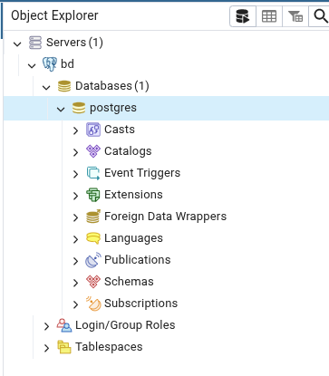

# Pasos para Ejecutar el Proyecto

Insertar archivo .env 

Insertar archivo con datos en carpeta data

Inicia los servicios con Docker:

    docker compose up --build

FastAPI estará en http://localhost:8000

(Al poner /docs aparecen todos los endpoints con su descripcion)

PostgreSQL estará accesible en localhost:5432

Para detener los servicios:

    docker compose down

Para eliminar los volumenes:

    docker compose down -v

Para reiniciar servicios (En caso de utilizar ctrl-c)

    docker compose restart
    docker compose logs --follow

Para subir archivos csv:

http://localhost:5050

usuario y contraseña definidos en archivo .env (puedes cambiar el correo, no reocomiendo cambiar la contraseña)

para conectar, usar los sig datos:

hostname: db
port: 5432

username: postgres
password: postgres

abrir servidor en menu lateral y luego seleccionar la base de datos postgres, ahi hacer click en query tool (boton que esta al lado de donde dice object explorer)

una vez en la ventana pegar el siguiente codigo y ejecutar las siguientes query (en orden):

Funcion SQL para EDT

    -- Función ETL mejorada con manejo robusto de errores y validaciones
    CREATE OR REPLACE FUNCTION etl_obras_medicion_to_dimensional()
    RETURNS TRIGGER AS $$
    DECLARE
        -- Variables para almacenar las claves foráneas
        v_id_ubicacion INT;
        v_id_acuifero INT;
        v_id_tiempo INT;
        v_id_informante INT;
        v_id_tipo_obra INT;
        v_id_estado_obra INT;
        v_id_obra INT;
        
        -- Variables para manejo de errores
        v_error_msg TEXT;
        v_step TEXT;

    BEGIN
        -- Validaciones iniciales
        IF NEW.fecha_medicion IS NULL THEN
            RAISE WARNING 'ETL: fecha_medicion es NULL para registro ID: %', COALESCE(NEW.id, 'UNKNOWN');
            RETURN NEW; -- Salir sin procesar
        END IF;

        BEGIN
            -- 1. Manejo de DimAcuifero con patrón INSERT + SELECT
            v_step := 'DimAcuifero';
            
            -- Intentar insertar
            INSERT INTO dim_acuifero (cod_acuifero, nom_acuifero)
            VALUES (
                COALESCE(NEW.cod_acuifero::TEXT, '-1'), 
                COALESCE(NEW.nom_acuifero, 'Desconocido')
            )
            ON CONFLICT (cod_acuifero) DO UPDATE
            SET nom_acuifero = CASE 
                WHEN EXCLUDED.nom_acuifero != 'Desconocido' THEN EXCLUDED.nom_acuifero
                ELSE dim_acuifero.nom_acuifero
            END;
            
            -- Obtener el ID siempre
            SELECT id_acuifero INTO STRICT v_id_acuifero 
            FROM dim_acuifero 
            WHERE cod_acuifero = COALESCE(NEW.cod_acuifero::TEXT, '-1');

            -- 2. Manejo de DimTiempo
            v_step := 'DimTiempo';
            
            INSERT INTO dim_tiempo (fecha_completa, dia, mes, ano)
            VALUES (
                NEW.fecha_medicion::DATE,
                EXTRACT(DAY FROM NEW.fecha_medicion)::INT,
                EXTRACT(MONTH FROM NEW.fecha_medicion)::INT,
                EXTRACT(YEAR FROM NEW.fecha_medicion)::INT
            )
            ON CONFLICT (fecha_completa) DO NOTHING;
            
            SELECT id_tiempo INTO STRICT v_id_tiempo 
            FROM dim_tiempo 
            WHERE fecha_completa = NEW.fecha_medicion::DATE;

            -- 3. Manejo de DimInformante
            v_step := 'DimInformante';
            
            INSERT INTO dim_informante (rut_informante, nombre_informante)
            VALUES (
                COALESCE(NEW.rut_inf, 'DESCONOCIDO-' || COALESCE(NEW.id::TEXT, 'NULL')),
                COALESCE(NEW.nomb_inf, 'Desconocido')
            )
            ON CONFLICT (rut_informante) DO UPDATE 
            SET nombre_informante = CASE 
                WHEN EXCLUDED.nombre_informante != 'Desconocido' THEN EXCLUDED.nombre_informante
                ELSE dim_informante.nombre_informante
            END;
            
            SELECT id_informante INTO STRICT v_id_informante 
            FROM dim_informante 
            WHERE rut_informante = COALESCE(NEW.rut_inf, 'DESCONOCIDO-' || COALESCE(NEW.id::TEXT, 'NULL'));

            -- 4. Manejo de DimTipoObra
            v_step := 'DimTipoObra';
            
            INSERT INTO dim_tipo_obra (descripcion)
            VALUES (COALESCE(NEW.tipo_obra::TEXT, 'Desconocido'))
            ON CONFLICT (descripcion) DO NOTHING;
            
            SELECT id_tipo_obra INTO STRICT v_id_tipo_obra 
            FROM dim_tipo_obra 
            WHERE descripcion = COALESCE(NEW.tipo_obra::TEXT, 'Desconocido');

            -- 5. Manejo de DimEstadoObra
            v_step := 'DimEstadoObra';
            
            INSERT INTO dim_estado_obra (descripcion)
            VALUES (COALESCE(NEW.estado_obra::TEXT, 'Desconocido'))
            ON CONFLICT (descripcion) DO NOTHING;
            
            SELECT id_estado_obra INTO STRICT v_id_estado_obra 
            FROM dim_estado_obra 
            WHERE descripcion = COALESCE(NEW.estado_obra::TEXT, 'Desconocido');

            -- 6. Manejo de DimUbicacion (después de obtener v_id_acuifero)
            v_step := 'DimUbicacion';
            
            INSERT INTO dim_ubicacion (
                region, provincia, comuna, cod_cuenca, nom_cuenca, 
                cod_subcuenca, nom_subcuenca, cod_subsubcuenca, nom_subsubcuenca, 
                utm_norte, utm_este, huso, nombre_fuente, cod_fuente_superficial, 
                id_acuifero
            )
            VALUES (
                COALESCE(NEW.region, -1),
                COALESCE(NEW.provincia, -1),
                COALESCE(NEW.comuna, -1),
                COALESCE(NEW.cod_cuenca, -1),
                COALESCE(NEW.nom_cuenca, 'Desconocido'),
                COALESCE(NEW.cod_subcuenca::TEXT, '-1'),
                COALESCE(NEW.nom_subcuenca, 'Desconocido'),
                COALESCE(NEW.cod_subsubcuenca::TEXT, '-1'),
                COALESCE(NEW.nom_subsubcuenca, 'Desconocido'),
                COALESCE(NEW.utm_norte, -1),
                COALESCE(NEW.utm_este, -1),
                COALESCE(NEW.huso, -1),
                COALESCE(NEW.nombre_fuente, 'Desconocido'),
                COALESCE(NEW.cod_fuente_superficial::TEXT, '-1'),
                v_id_acuifero
            )
            ON CONFLICT (utm_norte, utm_este, huso, id_acuifero) DO NOTHING;
            
            SELECT id_ubicacion INTO STRICT v_id_ubicacion 
            FROM dim_ubicacion 
            WHERE utm_norte = COALESCE(NEW.utm_norte, -1)
            AND utm_este = COALESCE(NEW.utm_este, -1)
            AND huso = COALESCE(NEW.huso, -1)
            AND id_acuifero = v_id_acuifero;

            -- 7. Manejo de DimObra
            v_step := 'DimObra';
            
            IF NEW.id_med_obr IS NOT NULL THEN
                INSERT INTO dim_obra (id_med_obr, nombre_obra, id_informante, id_tipo_obra, id_estado_obra)
                VALUES (
                    NEW.id_med_obr,
                    COALESCE(NEW.nombre_obra, 'Desconocido'),
                    v_id_informante,
                    v_id_tipo_obra,
                    v_id_estado_obra
                )
                ON CONFLICT (id_med_obr) DO UPDATE SET
                    nombre_obra = CASE 
                        WHEN EXCLUDED.nombre_obra != 'Desconocido' THEN EXCLUDED.nombre_obra
                        ELSE dim_obra.nombre_obra
                    END,
                    id_informante = EXCLUDED.id_informante,
                    id_tipo_obra = EXCLUDED.id_tipo_obra,
                    id_estado_obra = EXCLUDED.id_estado_obra;
                
                SELECT id_obra INTO STRICT v_id_obra 
                FROM dim_obra 
                WHERE id_med_obr = NEW.id_med_obr;
            ELSE
                RAISE WARNING 'ETL: id_med_obr es NULL para registro ID: %, saltando inserción en FactCaudales', COALESCE(NEW.id, 'UNKNOWN');
                RETURN NEW;
            END IF;

            -- 8. Validación final e inserción en FactCaudales
            v_step := 'FactCaudales';
            
            IF NEW.caudal IS NOT NULL AND NEW.caudal >= 0 THEN
                -- Verificar que todas las claves foráneas estén presentes
                IF v_id_ubicacion IS NULL THEN
                    RAISE EXCEPTION 'ETL: v_id_ubicacion es NULL';
                END IF;
                IF v_id_tiempo IS NULL THEN
                    RAISE EXCEPTION 'ETL: v_id_tiempo es NULL';
                END IF;
                IF v_id_obra IS NULL THEN
                    RAISE EXCEPTION 'ETL: v_id_obra es NULL';
                END IF;
                
                -- Verificar si ya existe este registro (evitar duplicados)
                IF NOT EXISTS (
                    SELECT 1 FROM fact_caudales 
                    WHERE id_ubicacion = v_id_ubicacion 
                    AND id_tiempo = v_id_tiempo 
                    AND id_obra = v_id_obra
                ) THEN
                    INSERT INTO fact_caudales (caudal_m3s, id_ubicacion, id_tiempo, id_obra)
                    VALUES (NEW.caudal, v_id_ubicacion, v_id_tiempo, v_id_obra);
                    
                    RAISE NOTICE 'ETL: Registro procesado exitosamente. ID: %, Caudal: % m³/s', 
                        COALESCE(NEW.id, 'UNKNOWN'), NEW.caudal;
                ELSE
                    RAISE NOTICE 'ETL: Registro duplicado detectado, saltando inserción en FactCaudales';
                END IF;
            ELSE
                RAISE NOTICE 'ETL: Caudal inválido (NULL o negativo: %) para registro ID: %', 
                    NEW.caudal, COALESCE(NEW.id, 'UNKNOWN');
            END IF;

        EXCEPTION
            WHEN NO_DATA_FOUND THEN
                v_error_msg := 'No se encontraron datos en step: ' || v_step;
                RAISE WARNING 'ETL Error - %: ID registro: %', v_error_msg, COALESCE(NEW.id, 'UNKNOWN');
                RETURN NEW;
            WHEN TOO_MANY_ROWS THEN
                v_error_msg := 'Múltiples filas encontradas en step: ' || v_step;
                RAISE WARNING 'ETL Error - %: ID registro: %', v_error_msg, COALESCE(NEW.id, 'UNKNOWN');
                RETURN NEW;
            WHEN OTHERS THEN
                v_error_msg := 'Error inesperado en step: ' || v_step || ' - ' || SQLERRM;
                RAISE WARNING 'ETL Error - %: ID registro: %', v_error_msg, COALESCE(NEW.id, 'UNKNOWN');
                RETURN NEW;
        END;

        RETURN NEW;
    END;
    $$ LANGUAGE plpgsql;

    -- Script para crear índices únicos necesarios
    -- EJECUTAR ESTOS COMANDOS DESPUÉS DE CREAR LA FUNCIÓN:
    /*
    -- Crear índices únicos necesarios para evitar conflictos
    CREATE UNIQUE INDEX IF NOT EXISTS idx_dim_acuifero_cod 
    ON dim_acuifero (cod_acuifero);

    CREATE UNIQUE INDEX IF NOT EXISTS idx_dim_informante_rut 
    ON dim_informante (rut_informante);

    CREATE UNIQUE INDEX IF NOT EXISTS idx_dim_tipo_obra_desc 
    ON dim_tipo_obra (descripcion);

    CREATE UNIQUE INDEX IF NOT EXISTS idx_dim_estado_obra_desc 
    ON dim_estado_obra (descripcion);

    -- Constraint de unicidad para ubicaciones (sin hash)
    CREATE UNIQUE INDEX IF NOT EXISTS idx_dim_ubicacion_unique
    ON dim_ubicacion (utm_norte, utm_este, huso, id_acuifero);
    */

Trigger SQL para EDT

    -- =====================================================
    -- TRIGGER ETL MEJORADO CON CONTROL Y VALIDACIONES
    -- =====================================================

    -- 1. Tabla de configuración para controlar el ETL
    CREATE TABLE IF NOT EXISTS etl_config (
        id SERIAL PRIMARY KEY,
        etl_enabled BOOLEAN DEFAULT TRUE,
        last_updated TIMESTAMP DEFAULT CURRENT_TIMESTAMP,
        updated_by VARCHAR(50) DEFAULT CURRENT_USER,
        notes TEXT
    );

    -- Insertar configuración inicial
    INSERT INTO etl_config (etl_enabled, notes) 
    VALUES (TRUE, 'ETL habilitado por defecto')
    ON CONFLICT DO NOTHING;

    -- 2. Tabla de log para auditoría del ETL
    CREATE TABLE IF NOT EXISTS etl_log (
        id SERIAL PRIMARY KEY,
        trigger_operation VARCHAR(10),
        source_table VARCHAR(50),
        source_record_id INT,
        execution_time TIMESTAMP DEFAULT CURRENT_TIMESTAMP,
        execution_duration_ms INTEGER,
        status VARCHAR(20) CHECK (status IN ('SUCCESS', 'WARNING', 'ERROR', 'SKIPPED')),
        error_message TEXT,
        records_processed INTEGER DEFAULT 1
    );

    -- 3. Función auxiliar para verificar si el ETL está habilitado
    CREATE OR REPLACE FUNCTION is_etl_enabled()
    RETURNS BOOLEAN AS $$
    DECLARE
        etl_status BOOLEAN;
    BEGIN
        SELECT etl_enabled INTO etl_status 
        FROM etl_config 
        ORDER BY last_updated DESC 
        LIMIT 1;
        
        RETURN COALESCE(etl_status, FALSE);
    END;
    $$ LANGUAGE plpgsql;

    -- 4. Función wrapper que controla la ejecución del ETL
    CREATE OR REPLACE FUNCTION etl_obras_medicion_controller()
    RETURNS TRIGGER AS $$
    DECLARE
        start_time TIMESTAMP;
        end_time TIMESTAMP;
        execution_duration INTEGER;
        etl_status VARCHAR(20) := 'SUCCESS';
        error_msg TEXT := NULL;
        source_id INT;
    BEGIN
        start_time := CLOCK_TIMESTAMP();
        source_id := COALESCE(NEW.id, OLD.id);
        
        -- Verificar si el ETL está habilitado
        IF NOT is_etl_enabled() THEN
            INSERT INTO etl_log (trigger_operation, source_table, source_record_id, status, error_message)
            VALUES (TG_OP, TG_TABLE_NAME, source_id, 'SKIPPED', 'ETL deshabilitado por configuración');
            
            RETURN COALESCE(NEW, OLD);
        END IF;
        
        -- Log del inicio de operación
        RAISE NOTICE 'ETL Controller: Iniciando procesamiento % para registro ID: %', TG_OP, source_id;
        
        BEGIN
            -- Ejecutar la función ETL según la operación
            CASE TG_OP
                WHEN 'INSERT' THEN
                    -- Validaciones específicas para INSERT
                    IF NEW.fecha_medicion IS NULL THEN
                        etl_status := 'WARNING';
                        error_msg := 'fecha_medicion es NULL';
                        RAISE WARNING 'ETL Controller: Saltando procesamiento - fecha_medicion es NULL para ID: %', source_id;
                    ELSIF NEW.caudal IS NULL OR NEW.caudal < 0 THEN
                        etl_status := 'WARNING'; 
                        error_msg := 'caudal inválido: ' || COALESCE(NEW.caudal::TEXT, 'NULL');
                        RAISE WARNING 'ETL Controller: Caudal inválido para ID: % - Valor: %', source_id, NEW.caudal;
                    ELSE
                        -- Ejecutar ETL para INSERT
                        PERFORM etl_obras_medicion_to_dimensional();
                    END IF;
                    
                WHEN 'UPDATE' THEN
                    -- Solo procesar si cambió información relevante
                    IF (OLD.caudal IS DISTINCT FROM NEW.caudal) OR
                    (OLD.fecha_medicion IS DISTINCT FROM NEW.fecha_medicion) OR
                    (OLD.estado_obra IS DISTINCT FROM NEW.estado_obra) THEN
                        
                        RAISE NOTICE 'ETL Controller: Cambios detectados en campos relevantes para ID: %', source_id;
                        -- Aquí podrías implementar lógica de UPDATE específica
                        -- Por ahora, ejecutamos el ETL normal
                        PERFORM etl_obras_medicion_to_dimensional();
                    ELSE
                        etl_status := 'SKIPPED';
                        error_msg := 'Sin cambios en campos relevantes';
                        RAISE NOTICE 'ETL Controller: Sin cambios relevantes para ID: %', source_id;
                    END IF;
                    
                WHEN 'DELETE' THEN
                    -- Marcar registros como eliminados en lugar de borrar
                    etl_status := 'WARNING';
                    error_msg := 'DELETE detectado - revisar manualmente';
                    RAISE WARNING 'ETL Controller: DELETE detectado para ID: % - Revisar impacto en dimensiones', source_id;
            END CASE;
            
        EXCEPTION
            WHEN OTHERS THEN
                etl_status := 'ERROR';
                error_msg := 'Error en ETL: ' || SQLERRM;
                RAISE WARNING 'ETL Controller Error: % para registro ID: %', SQLERRM, source_id;
        END;
        
        -- Calcular duración de ejecución
        end_time := CLOCK_TIMESTAMP();
        execution_duration := EXTRACT(MILLISECONDS FROM (end_time - start_time));
        
        -- Registrar en log
        INSERT INTO etl_log (
            trigger_operation, 
            source_table, 
            source_record_id, 
            execution_duration_ms,
            status, 
            error_message
        )
        VALUES (
            TG_OP, 
            TG_TABLE_NAME, 
            source_id, 
            execution_duration,
            etl_status, 
            error_msg
        );
        
        -- Log de finalización
        RAISE NOTICE 'ETL Controller: Finalizado % para ID: % - Status: % - Duración: %ms', 
            TG_OP, source_id, etl_status, execution_duration;
        
        RETURN COALESCE(NEW, OLD);
    END;
    $$ LANGUAGE plpgsql;

    -- 5. Eliminar trigger anterior si existe
    DROP TRIGGER IF EXISTS obras_medicion_etl_trigger ON obras_medicion;

    -- 6. Crear trigger mejorado con soporte para INSERT, UPDATE y DELETE
    CREATE TRIGGER obras_medicion_etl_trigger
        AFTER INSERT OR UPDATE OR DELETE ON obras_medicion
        FOR EACH ROW
        EXECUTE FUNCTION etl_obras_medicion_controller();

    -- =====================================================
    -- FUNCIONES DE UTILIDAD PARA GESTIONAR EL ETL
    -- =====================================================

    -- Función para deshabilitar el ETL temporalmente
    CREATE OR REPLACE FUNCTION disable_etl(reason TEXT DEFAULT NULL)
    RETURNS VOID AS $$
    BEGIN
        INSERT INTO etl_config (etl_enabled, notes)
        VALUES (FALSE, COALESCE(reason, 'ETL deshabilitado manualmente'));
        
        RAISE NOTICE 'ETL deshabilitado. Razón: %', COALESCE(reason, 'No especificada');
    END;
    $$ LANGUAGE plpgsql;

    -- Función para habilitar el ETL
    CREATE OR REPLACE FUNCTION enable_etl(reason TEXT DEFAULT NULL)
    RETURNS VOID AS $$
    BEGIN
        INSERT INTO etl_config (etl_enabled, notes)
        VALUES (TRUE, COALESCE(reason, 'ETL habilitado manualmente'));
        
        RAISE NOTICE 'ETL habilitado. Razón: %', COALESCE(reason, 'No especificada');
    END;
    $$ LANGUAGE plpgsql;

    -- Función para ver el estado del ETL
    CREATE OR REPLACE FUNCTION etl_status()
    RETURNS TABLE (
        enabled BOOLEAN,
        last_updated TIMESTAMP,
        updated_by VARCHAR(50),
        notes TEXT
    ) AS $$
    BEGIN
        RETURN QUERY
        SELECT etl_enabled, last_updated, updated_by, notes
        FROM etl_config
        ORDER BY last_updated DESC
        LIMIT 1;
    END;
    $$ LANGUAGE plpgsql;

    -- Vista para monitoreo del ETL
    CREATE OR REPLACE VIEW v_etl_monitoring AS
    SELECT 
        DATE(execution_time) as fecha,
        trigger_operation,
        status,
        COUNT(*) as cantidad,
        AVG(execution_duration_ms) as duracion_promedio_ms,
        MAX(execution_duration_ms) as duracion_maxima_ms,
        COUNT(*) FILTER (WHERE status = 'ERROR') as errores,
        COUNT(*) FILTER (WHERE status = 'WARNING') as warnings
    FROM etl_log
    WHERE execution_time >= CURRENT_DATE - INTERVAL '7 days'
    GROUP BY DATE(execution_time), trigger_operation, status
    ORDER BY fecha DESC, trigger_operation, status;

Copiar datos CSV

    COPY public.obras_medicion(
        "ID.MED.OBR",
        id_informante,
        id_junta,
        region,
        provincia,
        comuna,
        utm_norte,
        utm_este,
        huso,
        codigo,
        naturaleza,
        cod_cuenca,
        nom_cuenca,
        cod_acuifero,
        nom_acuifero,
        sector_sha,
        cod_subcuenca,
        nom_subcuenca,
        cod_subsubcuenca,
        nom_subsubcuenca,
        cod_fuente_superficial,
        nom_fuente_superficial,
        nombre_fuente,
        extrae_canal,
        nombre_canal,
        apr,
        puntoalt,
        tiene_motobomba,
        tiene_bocatoma,
        tipo_bocatoma,
        descarga_cauce_natural,
        habilitada,
        motivo_deshabilitada,
        motivo_otra,
        estado_obra,
        motivo_cambio_estado,
        fecha_cambio_estado,
        motivo_cambio_informante,
        nombre_obra,
        tipo_obra,
        cod_sector_sha,
        representa_junta,
        parte_junta,
        "RUT.INF.",
        "TIP.INF.",
        "NOMB.INF.",
        "A.PAT.INF.",
        "A.MAT.INF.",
        nacionalidad,
        "GEN.INF",
        "REG.INF.",
        "PROV.INF.",
        "COM.INF.",
        "DIR.INF",
        "TEL.FIJ.INF.",
        "TEL.MOV.INF",
        "EMAIL.INF",
        "RUT.USU.",
        "TIP.USU.",
        "NOMB.USU.",
        "A.PAT.USU.",
        "A.MAT.USU.",
        "REG.USU.",
        "PRO.USU.",
        com_usu,
        gen_usu,
        dir_usu,
        tel_fij_usu,
        tel_mov_usu,
        email_usu,
        id_med,
        id_obra_captacion,
        canal_transmision,
        tipo_medicion,
        fecha_medicion,
        fecha_origen,
        caudal,
        altura_limnimetrica,
        totalizador,
        nivel_freatico,
        rut_empresa
    )
    FROM '/var/lib/postgresql/datafiles/OBRAS_MEDICION.csv'
    WITH (
        FORMAT csv,
        HEADER true,
        DELIMITER ';',
        QUOTE '"'
    );

